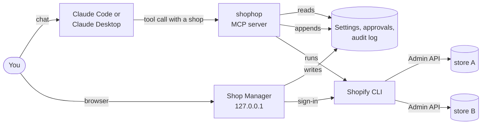
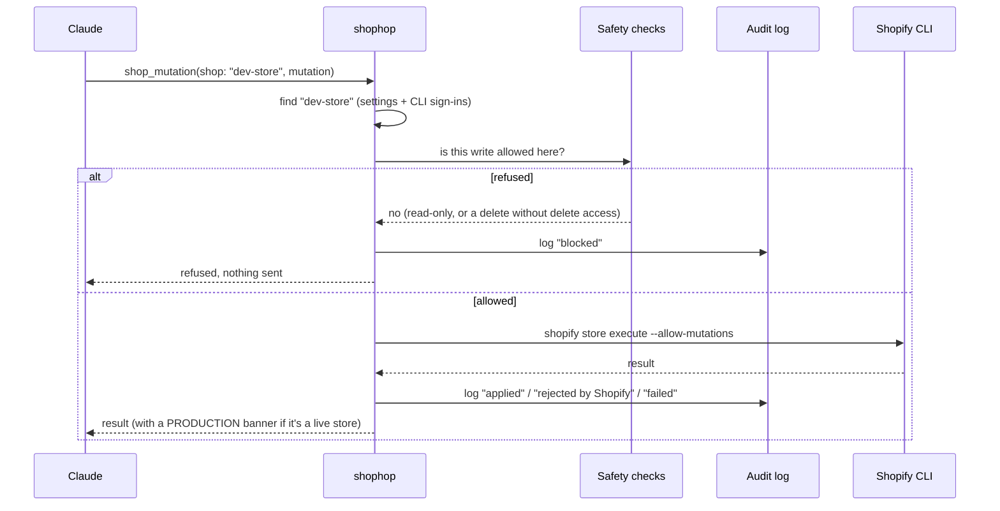

# How shophop works

shophop is a small program that runs on your computer (macOS, Windows or Linux) and sits between Claude and your Shopify stores. Claude asks it to do things (look something up, change something, copy companies), and shophop checks whether that's allowed and then does it through the Shopify CLI. You decide what's allowed in a local web page, the Shop Manager.



## The parts

| Part | What it is |
|---|---|
| **MCP server** | What Claude talks to. It offers tools like `shop_query` and `shop_copy_companies`, and every tool takes the store to use as an argument. |
| **Shopify CLI** | Shopify's own command-line tool. shophop uses its `shopify store` commands to sign in and call the Admin API. shophop never handles store tokens itself. |
| **Shop Manager** | A local web page where you add stores, sign in, decide what Claude may do on each, and approve copies into production. Claude can open it for you, but only you use it (enforced by the rules `shophop setup protect` adds). |
| **Settings, approvals, audit log** | Small files in `~/.config/shophop/`. The Shop Manager writes the settings and approvals; shophop reads them and appends to the audit log. |

## One active shop vs. one store per call

The claude.ai Shopify connector keeps a single active shop per account, so switching it in one terminal switches it everywhere. shophop has no active shop. Every tool call names its store:

```
shop_query(shop: "dev-store", query: "{ productsCount { count } }")
shop_query(shop: "prod-store", query: "{ productsCount { count } }")
```

So different terminals, tasks, or even two calls in the same chat can each use a different store.

## Signing in, without a custom app

When you click **Sign in with Shopify** in the Shop Manager, shophop runs `shopify store auth` for that store with the scopes you ticked. The Shopify CLI opens your browser, you approve with your normal staff account, and the CLI stores the token on your computer. shophop only ever asks the CLI to run commands; it never reads the token.

What that means in practice:

- **Your permissions apply.** Claude can only do what your staff account can do in that store, and only within the scopes you granted.
- **Tokens refresh themselves.** The CLI handles that.
- **Removing a store hides it.** The Shopify CLI can't sign out of a store, so **Remove** in the Shop Manager hides the store from shophop instead. Claude can't use it until you restore it or sign in again.

## What happens on a tool call



Reads (`shop_query`, `shop_schema`, exports) skip the safety checks and the log, but they still name their store. Large results are written to a file and Claude gets the path, so thousands of rows don't flood the conversation.

## The safety checks

Each store has settings that only you can change, in the Shop Manager:

| Setting | Default | What it controls |
|---|---|---|
| **What Claude can do** | Read only | *Read only* refuses every write. *Read & edit* allows creates and updates. *Read, edit & delete* also allows deletes. |
| **Environment** | Development | *Production* adds a red badge, a `PRODUCTION` banner on Claude's replies about the store, and approvals for copies into it. |
| **Data Claude can use** | Products, Customers (read) | Becomes the Shopify scopes requested at sign-in. Shopify itself refuses anything outside them. |

How a write is judged:

1. **Read only?** Refused.
2. **Destructive?** A mutation whose name means deleting, removing, revoking, cancelling or clearing, moving money (refund, capture, void), closing, deactivating, disabling, unpublishing, archiving or merging, or a bulk mutation, is refused unless the store has delete access. shophop reads the mutation the way Shopify does, including aliases and fragments, so the name can't be hidden. A mutation it can't fully read is treated as destructive, to be safe.

   This goes by the mutation's name, not its values: an ordinary update that sets something harmful (for example `productUpdate` with status `ARCHIVED`) counts as an edit.
3. **Otherwise:** sent, and logged.

Production approval is part of the company copy only. A production store set to *Read & edit* accepts other `shop_mutation` writes without an approval, so keep production stores on *Read only* except while you need them.

**Claude can't loosen these itself.** The settings live in `~/.config/shophop/`, and the Claude Code rules added by `shophop setup protect` block Claude from editing that folder or calling the Shop Manager's local API. Claude Code also asks you before each `shop_mutation`.

## Copying B2B companies

`shop_copy_companies` (or `shophop copy-companies` in a terminal) copies companies with their locations, contacts, main contact and roles:

1. **Export.** A Shopify bulk export of the source store's companies is saved to a file.
2. **Plan (dry run).** shophop reads the target store and plans what to do:
   - companies with the same name or external ID already in the target are **skipped, not merged**
   - contacts whose email already belongs to a customer in the target **reuse that customer**
   - payment terms are matched by type and due days, with a warning when there's no match

   Nothing is written. Claude shows you the plan.
3. **Approval, if the target is production.** The dry run files a request, and you approve it in the Shop Manager by typing the store's domain. The approval covers that exact export and store pair, for 24 hours.
4. **Apply.** Companies are created in batches. After every step (company, each location, each contact, main contact, roles), shophop records the new ID in an **ID map**. If anything fails, running the same copy again continues where it stopped and never creates duplicates.

Not copied: catalogs and price lists, staff assignments, metafields, orders, store credit, deposits.

## Bulk exports

For more than a few hundred records, `shop_bulk_export` starts a Shopify bulk query and waits up to 20 seconds. Small exports come back finished. Larger ones return an operation ID, and `shop_bulk_status` checks on it and downloads the result once it's done. Nothing is kept in memory between calls, so you can restart Claude halfway through and pick it up again.

## The audit log

Every write attempt is appended to `~/.config/shophop/audit.log`, whether it was applied, rejected by Shopify, failed or blocked. Each entry records:

- the time, store and staff user
- who sent it: Claude, the Shop Manager or the terminal
- which mutation, its variables and a shortened result
- any errors Shopify returned

A new file starts each month and the last 12 are kept. You can read it in the Shop Manager's **Activity** panel, with `shophop audit`, or by asking Claude "what did we change on store X?". It never leaves your computer.

## Claude Desktop specifics

Claude Desktop starts shophop differently from a terminal, and shophop handles a few quirks of that:

- **Claude Desktop doesn't pass on your terminal's PATH.** shophop looks for the Shopify CLI in the usual install folders (nvm, Homebrew, Volta, asdf, npm's global folder) and remembers where it found it. On macOS and Linux, only if that fails does it ask your login shell, in the background. Claude Desktop gives up on a server that doesn't answer within a few seconds, so startup never waits for it.
- **An older Node may come first.** The Shopify CLI needs a recent Node. shophop runs it with the Node installed next to it, not whichever `node` happens to come first on PATH.
- **Windows installs the CLI as `shopify.cmd`.** Programs can't start a `.cmd` file without going through `cmd.exe`, which would also mangle the JSON shophop passes. So shophop finds the CLI's JavaScript entry (`node_modules\@shopify\cli\bin\run.js` next to `shopify.cmd`) and runs it with Node directly. It also looks in Windows' usual install folders: npm's global folder, `Program Files\nodejs`, nvm-windows, Volta, Scoop.

It runs fully on your computer, which is also why **claude.ai on the web and mobile can't use it**: they can only reach servers on the internet.

## Where things are stored

| What | Where |
|---|---|
| Store settings, production approvals, audit log | `~/.config/shophop/` |
| Store sign-ins (tokens) | kept by the Shopify CLI: `~/Library/Preferences/shopify-cli-store-nodejs/` (macOS), `%APPDATA%\shopify-cli-store-nodejs\Config\` (Windows), `~/.config/shopify-cli-store-nodejs/` (Linux) |
| Exports, copy plans, ID maps | `./shopify-data/` in the Claude Code project folder; `~/shophop-data` for Claude Desktop |
| Where the Shopify CLI was found | `~/Library/Caches/shophop/` (macOS), `%LOCALAPPDATA%\shophop\Cache\` (Windows), `~/.cache/shophop/` (Linux) |

Nothing is sent anywhere except to Shopify, by the Shopify CLI.
